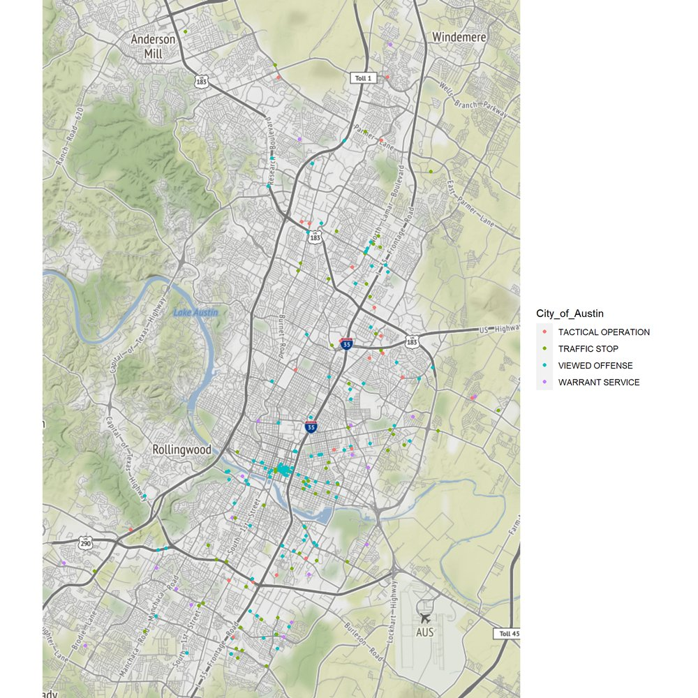

# Austin Police Use-of-Force Mapping

> **Historical portfolio artifact:** this repository preserves the rendered R Markdown report. The standalone source file is not included.

**[▶ View the rendered report](https://raw.githack.com/izzydi/austin-crime-geospatial-analysis/main/austin_crime_map.html)**

A geospatial visualisation in R of Austin Police Department use-of-force records for 2014–2016, from the Center for Policing Equity "Data Science for Good" data (department 37-00027). Incident locations are plotted on a street basemap and coloured by the nature of the police contact: traffic stop, viewed offense, warrant service or tactical operation.

The densest cluster of incidents is in downtown Austin.

## What the report covers

- Reading and summarising the department shapefile, then plotting a plain map.
- Reading the use-of-force CSV and counting incidents by location.
- Mapping incidents over a basemap, coloured by nature of contact.

The report itself refers to these records as crimes. They are use-of-force incident records, which is how this README describes them.

## Repository contents

- [`austin_crime_map.html`](austin_crime_map.html) — rendered report with code, outputs and maps.
- [`figures/`](figures/) — map exported from the report (resized).

## Reproducibility note

The R code is shown inside the rendered report, but the standalone R Markdown file is not in the repository. The report downloads the data from a GitHub copy of the Center for Policing Equity dataset.
